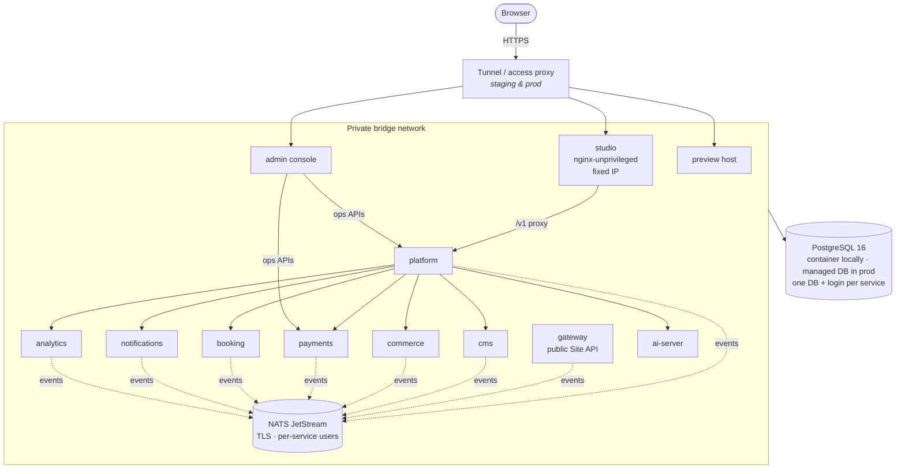

# Hardened Docker & Docker Compose Microservices Stack


This is the container setup for Andishi, a multi-service SaaS platform that builds and hosts websites for small businesses. It covers 11 Go and TypeScript services, each built from a multi-stage Dockerfile into a small distroless, non-root image. One set of Compose files runs them locally, and subsequent environments. Every application container runs read-only with every Linux capability dropped, on a private network, and event traffic goes over TLS-encrypted NATS JetStream with per-service permissions.

> My role: I containerized the platform and built the Compose stack: the Dockerfiles, the hardening defaults, the per-environment Compose files, the secrets bootstrap and the network design.

Addresses, ports, subjects and service names in the examples below are placeholders. The patterns are the ones used in the real stack.

## Highlights

| | |
|---|---|
| Distroless, non-root images | Go services run on `gcr.io/distroless/static` as `nonroot`. The images have no shell and no package manager, so there's very little to attack. |
| Multi-stage builds | The final image only gets the compiled program and a small health-check binary. Toolchains, source code and `node_modules` stay in the build stages. |
| Pinned by digest | Base images are pinned by tag and `@sha256` digest, so builds are reproducible and an upstream tag can't change underneath them. |
| Hardened runtime by default | One YAML anchor applies `read_only`, `cap_drop: ALL`, `no-new-privileges`, a tmpfs `/tmp` and log rotation to every app service. |
| Least-privilege messaging | Each service has its own NATS user. It can publish only the subjects it owns and consume only its own named consumers. |
| Least-privilege database | Each service has its own database and login, and Postgres row-level security isolates tenants. |
| No secrets in images or git | Local secrets are generated on first run. Staging and production pull secrets from AWS Secrets Manager when they deploy. |
| Dependency-aware startup | Every service has a health check, and `depends_on: condition: service_healthy` starts the stack in the right order. |
| Fast, small builds | BuildKit cache mounts keep Go modules and npm caches between builds. A per-Dockerfile `.dockerignore` keeps each build context small. |

## Architecture



### Services

Each container listens on its own port, and services reach each other by name on the private network.

| Service | Image base | Role |
|---|---|---|
| `studio` | `nginx-unprivileged` | React SPA. It also proxies `/v1` to the platform on the same origin |
| `platform` | distroless | Core API: auth, workspaces, site generation |
| `gateway` | distroless | Public Site API and shopper sign-in. Same image as `platform`, different entrypoint |
| `ai-server` | distroless | AI generation jobs |
| `cms` | distroless | Content and media |
| `commerce` | distroless | Products and orders |
| `payments` | distroless | Payment provider integrations |
| `notifications` | distroless | Email and SMS |
| `booking` | distroless | Appointments |
| `analytics` | distroless | Event analytics |
| `admin` | distroless | Operator console |
| `preview` | Node (non-root) | Signed site previews |
| `nats` | `nats:alpine` | Event backbone (JetStream) |
| `postgres` | `postgres:16-alpine` | Database: a container locally, a managed database in production |

## Dockerfile design

Every Go service follows the same pattern. Here's an example service (`orders`), slightly shortened:

```dockerfile
ARG GOLANG_IMAGE=golang:1.25-alpine3.23@sha256:<digest>
ARG RUNTIME_IMAGE=gcr.io/distroless/static-debian12:nonroot@sha256:<digest>
ARG VERSION=dev

# 1. Build: cache Go modules and the build cache between builds
FROM ${GOLANG_IMAGE} AS build
ARG VERSION
WORKDIR /src/orders
COPY shared /src/shared
COPY orders/go.mod orders/go.sum ./
RUN --mount=type=cache,target=/go/pkg/mod go mod download
COPY orders ./
RUN --mount=type=cache,target=/go/pkg/mod \
    --mount=type=cache,target=/root/.cache/go-build \
    CGO_ENABLED=0 go build -trimpath \
      -ldflags "-s -w -X .../shared/version.Version=${VERSION}" \
      -o /out/orders ./cmd/orders \
 && CGO_ENABLED=0 go build -trimpath -ldflags "-s -w" \
      -o /out/healthprobe .../shared/cmd/healthprobe

# 2. Runtime: two static binaries on distroless, nothing else
FROM ${RUNTIME_IMAGE}
LABEL org.opencontainers.image.title="example-orders" \
      org.opencontainers.image.version="${VERSION}"
COPY --from=build /out/orders /app/orders
COPY --from=build /out/healthprobe /app/healthprobe
USER nonroot:nonroot
HEALTHCHECK CMD ["/app/healthprobe", "http://127.0.0.1:8080/health"]
ENTRYPOINT ["/app/orders"]
```

How the Dockerfiles are built:

- A health check without a shell. Distroless images have no `curl` or `wget`, so every image ships a tiny static Go `healthprobe` binary, which both the Dockerfile `HEALTHCHECK` and the Compose health check use.
- Static, stripped binaries. `CGO_ENABLED=0`, `-trimpath` and `-s -w` give small, reproducible binaries that don't depend on libc.
- Version stamped in. `VERSION` is set at link time and added as an OCI label. CI passes `<env>-<commit-sha>`, so every running container can report which commit it came from.
- One image, two programs. The `platform` image contains both `/app/platform` and `/app/gateway`, and Compose runs the gateway by overriding `entrypoint`. The gateway refuses to start if any platform secret is in its environment.
- Frontend builds in Docker too. The platform's Dockerfile builds the website template app in a Node stage and embeds it in the Go binary. The studio's Dockerfile builds the Vite SPA and serves it from `nginx-unprivileged` on port 8080 as UID 101. Neither image ships Node, source maps or secrets.
- Monorepo-aware build contexts. Builds run from the repo root, because the Go modules share a common module and the frontends share an npm workspace. Each Dockerfile has its own `Dockerfile.dockerignore`, which starts with `*` and lists only what that image needs. `.env` files, `node_modules` and build output never reach the Docker daemon.

## Compose design

### A hardening anchor shared by every service

```yaml
x-hardened: &hardened
  read_only: true            # immutable root filesystem
  tmpfs: [/tmp]              # the only writable scratch space
  cap_drop: [ALL]            # no Linux capabilities
  security_opt:
    - no-new-privileges:true # no setuid escalation
  logging:
    driver: json-file
    options: { max-size: "10m", max-file: "3" }  # bounded disk use
  networks: [backend]

services:
  orders:
    <<: *hardened
    ...
```

Every app service merges this anchor in with `<<: *hardened`. The secure defaults apply everywhere, and a service has to opt out on purpose to be weaker.

### Network design

- One private bridge network. Services find each other by name through Docker's DNS.
- Ports are published on loopback only (`127.0.0.1:PORT`), so nothing is reachable from the LAN. In staging and production, a tunnel handles inbound traffic, so the host needs no open inbound web ports.
- The trusted proxy has a fixed IP. The studio's nginx is pinned to an address above the range Docker hands out automatically. The platform trusts the forwarded client-IP header only from that address, so other containers can't fake a client IP.
- Internal-only listeners. The workers' internal API, the ops APIs and the metrics endpoints are not published at all. Only containers on the network can reach them.

### Startup order and health

```yaml
orders:
  depends_on:
    postgres: { condition: service_healthy }
    nats:     { condition: service_healthy }
    platform: { condition: service_healthy }   # platform creates the stream this service reads from
  healthcheck:
    test: ["CMD", "/app/healthprobe", "http://127.0.0.1:8080/health"]
```

Each service waits until its dependencies report healthy. In staging and production, `restart: unless-stopped` brings crashed containers back up.

### Configuration fails fast

Required variables use Compose's `${VAR:?}` syntax:

```yaml
DATABASE_URL: postgres://orders:${DB_PASSWORD_ORDERS:?}@postgres:5432/orders
```

If a secret is missing, `docker compose up` fails right away. The service never starts with an empty password. A validation script, run by `make dev-check`, compares the Compose files with each service's `.env.example`, so config can't drift silently.

## Least privilege in the data layer

### NATS JetStream: one user per service

Clients connect over `tls://` and check the server against a CA mounted read-only. Passwords are stored as bcrypt hashes passed in through the environment. Each service's permissions name exactly the subjects and consumers it owns:

```text
user: orders
  publish:   orders.>                                  # its own events
             $JS.API.STREAM.{INFO,CREATE,UPDATE}.ORDERS  # its own stream only
             $JS.API.CONSUMER.*.ACCOUNTS.orders-cleanup
             dlq.orders-cleanup                        # its own dead-letter subject
  subscribe: _INBOX_orders.>                           # its own reply inbox only
```

If one service is compromised, it can't read another service's events or publish as another service. The NATS monitoring endpoint listens only on `127.0.0.1` inside the container.

### PostgreSQL: one database and login per service

The local init script sets up the same role model that production uses:

- Each service gets its own database and login. The orders login can't connect to another service's database.
- Two `NOLOGIN` roles per service: `<service>_app` for tenant queries, with row-level security enforced, and `<service>_maint` for migrations and maintenance jobs.
- The init script validates every generated password before using it in SQL.

## Environments

There's one Compose file per environment, all built on the same anchors and service definitions:

| | Local (`docker-compose.yml`) | Staging / Production |
|---|---|---|
| Images | Built from source (`build:`) | Pulled from the GitLab registry, after a Trivy scan |
| Postgres | Container, pinned by digest | Managed database (`sslmode=require`) |
| Secrets | Generated by a small Go tool (`devsecrets`) into a git-ignored `.env.local` | AWS Secrets Manager, fetched at deploy time |
| TLS certificates | Generated dev CA in `.dev/tls` | Stored in Secrets Manager |
| Mail / SMS | Logged to stdout | Managed email and SMS services |
| File storage | Named volumes | Object storage |
| Inbound traffic | `localhost` only | Tunnel ingress, with the admin console behind an access proxy |
| Admin approvals | Off | On |
| Restart policy | none | `unless-stopped` |

### Opt-in extras

- `--profile previews` adds a signed HTTPS preview host. It runs as your UID, with a read-only root filesystem and every capability dropped.
- `docker-compose.aws-profile.yml` is an override file that mounts your local `~/.aws` read-only into `ai-server` for AI model access. It clears any inline keys, so your profile is used, and turns off the EC2 metadata lookup. No credentials are copied into the image.

## Quick start (local)

```bash
make dev          # generate secrets + certs, build, start, wait until healthy
make dev-ps       # container status
make dev-logs     # follow logs
make dev-down     # stop, keep data
make dev-reset    # stop, delete volumes and generated secrets
```

`make dev` wraps `scripts/dev.sh`. On first run it generates every password, signing key and dev certificate into git-ignored files. Then it runs `docker compose --env-file .env.local up` and waits for every health check to pass. The studio is then at http://localhost:8080.

## Security checklist

| Control | How |
|---|---|
| Non-root containers | `USER nonroot` (distroless), UID 101 (nginx), `node` (preview) |
| Small attack surface | Distroless runtime: no shell, no package manager |
| Immutable filesystem | `read_only: true` and `tmpfs: /tmp` |
| No Linux capabilities | `cap_drop: [ALL]` |
| No privilege escalation | `no-new-privileges:true` |
| Reproducible base images | Tag and `@sha256` digest pinning |
| No secrets in images | Runtime environment only. `.dockerignore` blocks `.env*` |
| Network exposure | Loopback-only ports, internal-only APIs, tunnel ingress |
| Encrypted service-to-broker traffic | NATS over TLS 1.2+ with a pinned CA |
| Service isolation | Per-service NATS users and Postgres logins, plus row-level security |
| Disk exhaustion | Log rotation (`10m × 3`) and JetStream storage limits |
| Vulnerability scanning | Trivy gate in CI (see the [GitLab pipeline project](../gitlab-cicd-secure-container-pipeline/)) |

## Repository layout (container-related files)

```text
.
├── docker-compose.yml               # local stack (build from source)
├── docker-compose.staging.yml       # staging (registry images, managed database)
├── docker-compose.prod.yml          # production
├── docker-compose.aws-profile.yml   # optional: read-only local AWS profile for ai-server
├── Makefile                         # make dev / dev-down / dev-reset / ...
├── scripts/dev.sh                   # local stack entry point
├── <service>/Dockerfile             # one multi-stage Dockerfile per service
├── <service>/Dockerfile.dockerignore
└── infra/
    ├── nats/nats.conf               # TLS, JetStream limits
    ├── nats/accounts.conf           # per-service users and permissions
    └── dev/postgres/initdb/         # per-service roles, logins, RLS roles
```
